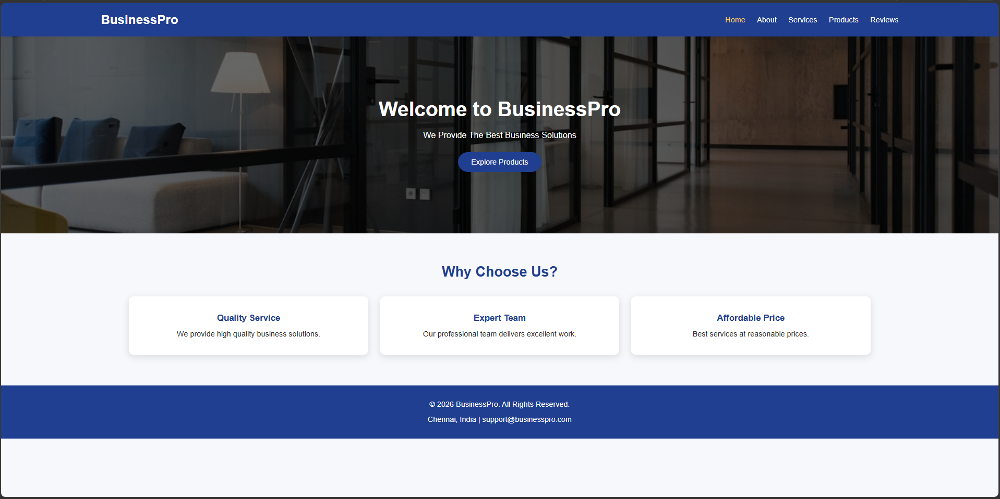
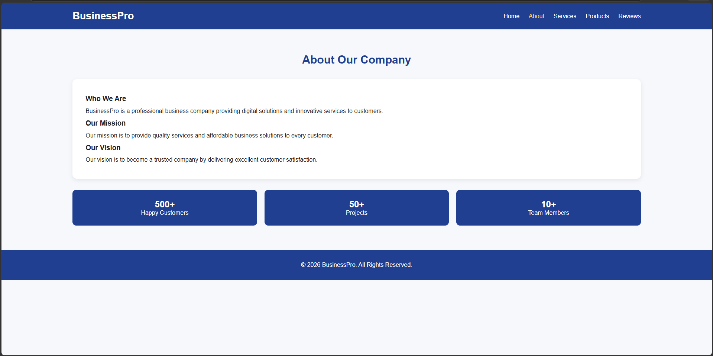
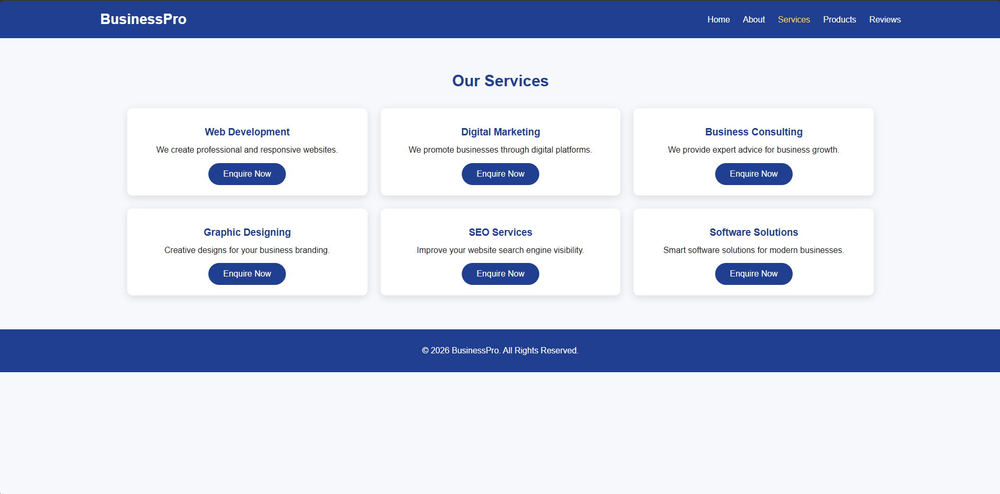
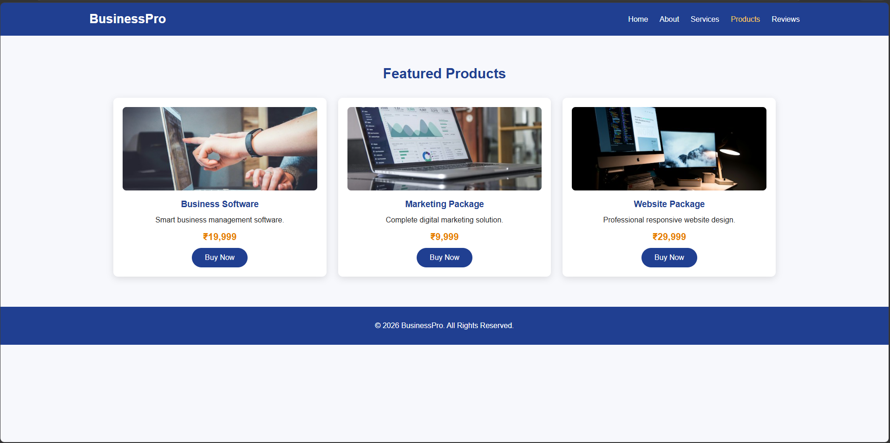
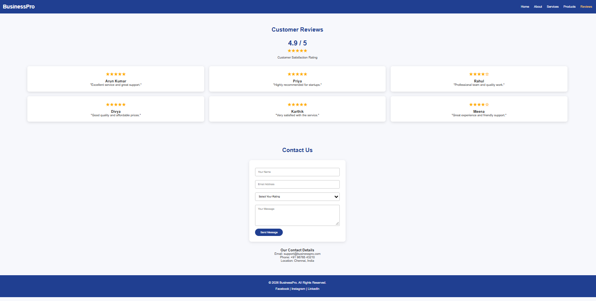

# Ex02 Commercial Website

## Date: 03/11/2026

## AIM
To create a commercial website using CSS Flexbox.

## ALGORITHM
### STEP 1
Create an HTML file (index.html)

### STEP 2
Create a CSS file (style.css)

### STEP 3
Include a navigation bar with links to different sections.

### STEP 4
Add structured sections for Homepage, Products / Services, About Us, Contact Details and User Account.

### STEP 5
Include social media links at the footer with copyright information.

### STEP 6
Define global styles for fonts, colors, and layout.

### STEP 7
Style the header, navigation bar, and sections.

### STEP 8
Use Flexbox for layout design.

### STEP 9
Add hover effects and transitions for interactivity.

### STEP 10
Add Images and Media.

### STEP 11
Use optimized images for a professional look.

### STEP 12
Open the HTML file in a browser to check layout and functionality.

### STEP 13
Fix styling issues and refine content placement.

### STEP 14
Deploy the website.

### STEP 15
Upload to GitHub Pages for free hosting.

## PROGRAM

## index.html
```
<!DOCTYPE html>
<html lang="en">
<head>
    <meta charset="UTF-8">
    <meta name="viewport" content="width=device-width, initial-scale=1.0">
    <title>BusinessPro - Home</title>
    <link rel="stylesheet" href="style.css">
</head>
<body>

<header>
    <nav class="navbar">
        <h1 class="logo">BusinessPro</h1>
        <ul class="nav-links">
            <li><a class="active" href="index.html">Home</a></li>
            <li><a href="about.html">About</a></li>
            <li><a href="services.html">Services</a></li>
            <li><a href="products.html">Products</a></li>
            <li><a href="reviews.html">Reviews</a></li>
        </ul>
    </nav>
</header>

<section class="hero">
    <div>
        <h2>Welcome to BusinessPro</h2>
        <p>We Provide The Best Business Solutions</p>
        <a href="products.html" class="btn">Explore Products</a>
    </div>
</section>

<section>
    <h2 class="heading">Why Choose Us?</h2>

    <div class="container">
        <div class="card">
            <h3>Quality Service</h3>
            <p>We provide high quality business solutions.</p>
        </div>

        <div class="card">
            <h3>Expert Team</h3>
            <p>Our professional team delivers excellent work.</p>
        </div>

        <div class="card">
            <h3>Affordable Price</h3>
            <p>Best services at reasonable prices.</p>
        </div>
    </div>
</section>

<footer>
    <p>© 2026 BusinessPro. All Rights Reserved.</p>
    <p>Chennai, India | support@businesspro.com</p>
</footer>

</body>
</html>
```

## style.css
```
* {
    margin: 0;
    padding: 0;
    box-sizing: border-box;
    font-family: Arial, sans-serif;
}

html {
    scroll-behavior: smooth;
}

body {
    background: #f7f8fc;
    color: #222;
}

/* Navigation */
.navbar {
    background: #203f91;
    color: white;
    padding: 20px 10%;
    display: flex;
    justify-content: space-between;
    align-items: center;
    flex-wrap: wrap;
    gap: 15px;
}

.logo {
    font-size: 27px;
}

.nav-links {
    display: flex;
    list-style: none;
    gap: 25px;
    flex-wrap: wrap;
}

.nav-links a {
    color: white;
    text-decoration: none;
    font-size: 16px;
}

.nav-links a:hover,
.nav-links a.active {
    color: #ffcc55;
}

/* Common heading */
.heading {
    text-align: center;
    color: #203f91;
    margin-bottom: 35px;
    font-size: 30px;
}

section {
    padding: 65px 10%;
}

/* Home Hero */
.hero {
    min-height: 420px;
    background:
    linear-gradient(rgba(0,0,0,.6), rgba(0,0,0,.6)),
    url("https://images.unsplash.com/photo-1497366754035-f200968a6e72?w=1400");

    background-size: cover;
    background-position: center;
    display: flex;
    justify-content: center;
    align-items: center;
    text-align: center;
    color: white;
}

.hero h2 {
    font-size: 43px;
    margin-bottom: 20px;
}

.hero p {
    font-size: 18px;
    margin-bottom: 25px;
}

.btn {
    display: inline-block;
    background: #203f91;
    color: white;
    text-decoration: none;
    padding: 12px 28px;
    border-radius: 25px;
    border: none;
    cursor: pointer;
}

.btn:hover {
    background: #ff9800;
}

/* Cards using Flexbox */
.container {
    display: flex;
    justify-content: center;
    align-items: stretch;
    flex-wrap: wrap;
    gap: 25px;
}

.card {
    background: white;
    width: 30%;
    min-width: 230px;
    padding: 20px;
    border-radius: 10px;
    text-align: center;
    box-shadow: 0 4px 15px rgba(0,0,0,.12);
    transition: .3s;
}

.card:hover {
    transform: translateY(-7px);
}

.card img {
    width: 100%;
    height: 180px;
    object-fit: cover;
    border-radius: 8px;
}

.card h3 {
    margin: 15px 0 10px;
    color: #203f91;
}

.card p {
    line-height: 1.6;
    margin-bottom: 12px;
}

.price {
    color: #e67e00;
    font-size: 20px;
    font-weight: bold;
    margin: 12px;
}

/* About */
.about-content {
    background: white;
    padding: 35px;
    border-radius: 12px;
    line-height: 1.9;
    box-shadow: 0 4px 12px rgba(0,0,0,.08);
}

/* Statistics */
.stats {
    display: flex;
    justify-content: space-around;
    flex-wrap: wrap;
    gap: 20px;
    margin-top: 30px;
}

.stat {
    text-align: center;
    background: #203f91;
    color: white;
    padding: 25px;
    border-radius: 10px;
    flex: 1;
    min-width: 150px;
}

/* Reviews */
.review-card {
    background: white;
    padding: 25px;
    width: 30%;
    min-width: 230px;
    border-radius: 10px;
    text-align: center;
    box-shadow: 0 4px 15px rgba(0,0,0,.12);
}

.stars {
    color: #ffae00;
    font-size: 25px;
    margin-bottom: 12px;
}

.rating {
    text-align: center;
    margin: 20px 0 35px;
}

.rating h2 {
    color: #203f91;
    font-size: 35px;
}

/* Contact Form */
.contact-form {
    max-width: 500px;
    margin: auto;
    background: white;
    padding: 30px;
    border-radius: 12px;
    box-shadow: 0 4px 15px rgba(0,0,0,.1);
}

.contact-form input,
.contact-form textarea,
.contact-form select {
    width: 100%;
    padding: 13px;
    margin: 10px 0;
    border: 1px solid #ccc;
    border-radius: 6px;
    outline: none;
}

.contact-form textarea {
    height: 110px;
    resize: vertical;
}

/* Footer */
footer {
    background: #203f91;
    color: white;
    text-align: center;
    padding: 25px;
    line-height: 2;
}

footer a {
    color: white;
    text-decoration: none;
}

/* Responsive */
@media(max-width: 768px) {
    .navbar {
        flex-direction: column;
    }

    .nav-links {
        justify-content: center;
        gap: 15px;
    }

    .hero h2 {
        font-size: 30px;
    }

    .card,
    .review-card {
        width: 45%;
    }
}

@media(max-width: 480px) {
    section {
        padding: 40px 5%;
    }

    .card,
    .review-card {
        width: 100%;
    }

    .hero h2 {
        font-size: 25px;
    }

    .heading {
        font-size: 25px;
    }
}
```

## about.html
```
<!DOCTYPE html>
<html lang="en">
<head>
    <meta charset="UTF-8">
    <meta name="viewport" content="width=device-width, initial-scale=1.0">
    <title>BusinessPro - About</title>
    <link rel="stylesheet" href="style.css">
</head>
<body>

<header>
    <nav class="navbar">
        <h1 class="logo">BusinessPro</h1>
        <ul class="nav-links">
            <li><a href="index.html">Home</a></li>
            <li><a class="active" href="about.html">About</a></li>
            <li><a href="services.html">Services</a></li>
            <li><a href="products.html">Products</a></li>
            <li><a href="reviews.html">Reviews</a></li>
        </ul>
    </nav>
</header>

<section>
    <h2 class="heading">About Our Company</h2>

    <div class="about-content">
        <h3>Who We Are</h3>

        <p>
            BusinessPro is a professional business company
            providing digital solutions and innovative services
            to customers.
        </p>

        <h3>Our Mission</h3>
        <p>
            Our mission is to provide quality services and
            affordable business solutions to every customer.
        </p>

        <h3>Our Vision</h3>
        <p>
            Our vision is to become a trusted company by
            delivering excellent customer satisfaction.
        </p>
    </div>

    <div class="stats">
        <div class="stat">
            <h2>500+</h2>
            <p>Happy Customers</p>
        </div>

        <div class="stat">
            <h2>50+</h2>
            <p>Projects</p>
        </div>

        <div class="stat">
            <h2>10+</h2>
            <p>Team Members</p>
        </div>
    </div>
</section>

<footer>
    <p>© 2026 BusinessPro. All Rights Reserved.</p>
</footer>

</body>
</html>
```

## services.html
```
<!DOCTYPE html>
<html lang="en">
<head>
    <meta charset="UTF-8">
    <meta name="viewport" content="width=device-width, initial-scale=1.0">
    <title>BusinessPro - Services</title>
    <link rel="stylesheet" href="style.css">
</head>
<body>

<header>
    <nav class="navbar">
        <h1 class="logo">BusinessPro</h1>
        <ul class="nav-links">
            <li><a href="index.html">Home</a></li>
            <li><a href="about.html">About</a></li>
            <li><a class="active" href="services.html">Services</a></li>
            <li><a href="products.html">Products</a></li>
            <li><a href="reviews.html">Reviews</a></li>
        </ul>
    </nav>
</header>

<section>
    <h2 class="heading">Our Services</h2>

    <div class="container">

        <div class="card">
            <h3>Web Development</h3>
            <p>We create professional and responsive websites.</p>
            <a href="reviews.html#contact" class="btn">Enquire Now</a>
        </div>

        <div class="card">
            <h3>Digital Marketing</h3>
            <p>We promote businesses through digital platforms.</p>
            <a href="reviews.html#contact" class="btn">Enquire Now</a>
        </div>

        <div class="card">
            <h3>Business Consulting</h3>
            <p>We provide expert advice for business growth.</p>
            <a href="reviews.html#contact" class="btn">Enquire Now</a>
        </div>

        <div class="card">
            <h3>Graphic Designing</h3>
            <p>Creative designs for your business branding.</p>
            <a href="reviews.html#contact" class="btn">Enquire Now</a>
        </div>

        <div class="card">
            <h3>SEO Services</h3>
            <p>Improve your website search engine visibility.</p>
            <a href="reviews.html#contact" class="btn">Enquire Now</a>
        </div>

        <div class="card">
            <h3>Software Solutions</h3>
            <p>Smart software solutions for modern businesses.</p>
            <a href="reviews.html#contact" class="btn">Enquire Now</a>
        </div>

    </div>
</section>

<footer>
    <p>© 2026 BusinessPro. All Rights Reserved.</p>
</footer>

</body>
</html>
```

## products.html
```
<!DOCTYPE html>
<html lang="en">
<head>
    <meta charset="UTF-8">
    <meta name="viewport" content="width=device-width, initial-scale=1.0">
    <title>BusinessPro - Products</title>
    <link rel="stylesheet" href="style.css">
</head>
<body>

<header>
    <nav class="navbar">
        <h1 class="logo">BusinessPro</h1>
        <ul class="nav-links">
            <li><a href="index.html">Home</a></li>
            <li><a href="about.html">About</a></li>
            <li><a href="services.html">Services</a></li>
            <li><a class="active" href="products.html">Products</a></li>
            <li><a href="reviews.html">Reviews</a></li>
        </ul>
    </nav>
</header>

<section>
    <h2 class="heading">Featured Products</h2>

    <div class="container">

        <div class="card">
            
            <h3>Business Software</h3>
            <p>Smart business management software.</p>
            <div class="price">₹19,999</div>
            <a href="reviews.html#contact" class="btn">Buy Now</a>
        </div>

        <div class="card">
            
            <h3>Marketing Package</h3>
            <p>Complete digital marketing solution.</p>
            <div class="price">₹9,999</div>
            <a href="reviews.html#contact" class="btn">Buy Now</a>
        </div>

        <div class="card">
            
            <h3>Website Package</h3>
            <p>Professional responsive website design.</p>
            <div class="price">₹29,999</div>
            <a href="reviews.html#contact" class="btn">Buy Now</a>
        </div>

    </div>
</section>

<footer>
    <p>© 2026 BusinessPro. All Rights Reserved.</p>
</footer>

</body>
</html>
```

## reviews.html
```
<!DOCTYPE html>
<html lang="en">
<head>
    <meta charset="UTF-8">
    <meta name="viewport" content="width=device-width, initial-scale=1.0">
    <title>BusinessPro - Reviews</title>
    <link rel="stylesheet" href="style.css">
</head>
<body>

<header>
    <nav class="navbar">
        <h1 class="logo">BusinessPro</h1>
        <ul class="nav-links">
            <li><a href="index.html">Home</a></li>
            <li><a href="about.html">About</a></li>
            <li><a href="services.html">Services</a></li>
            <li><a href="products.html">Products</a></li>
            <li><a class="active" href="reviews.html">Reviews</a></li>
        </ul>
    </nav>
</header>

<section>
    <h2 class="heading">Customer Reviews</h2>

    <div class="rating">
        <h2>4.9 / 5</h2>
        <div class="stars">★★★★★</div>
        <p>Customer Satisfaction Rating</p>
    </div>

    <div class="container">

        <div class="review-card">
            <div class="stars">★★★★★</div>
            <h3>Arun Kumar</h3>
            <p>"Excellent service and great support."</p>
        </div>

        <div class="review-card">
            <div class="stars">★★★★★</div>
            <h3>Priya</h3>
            <p>"Highly recommended for startups."</p>
        </div>

        <div class="review-card">
            <div class="stars">★★★★☆</div>
            <h3>Rahul</h3>
            <p>"Professional team and quality work."</p>
        </div>

        <div class="review-card">
            <div class="stars">★★★★★</div>
            <h3>Divya</h3>
            <p>"Good quality and affordable prices."</p>
        </div>

        <div class="review-card">
            <div class="stars">★★★★★</div>
            <h3>Karthik</h3>
            <p>"Very satisfied with the service."</p>
        </div>

        <div class="review-card">
            <div class="stars">★★★★☆</div>
            <h3>Meena</h3>
            <p>"Great experience and friendly support."</p>
        </div>

    </div>
</section>

<section id="contact">
    <h2 class="heading">Contact Us</h2>

    <div class="contact-form">
        <form action="#" method="post">

            <input type="text"
                   placeholder="Your Name"
                   required>

            <input type="email"
                   placeholder="Email Address"
                   required>

            <select required>
                <option value="">Select Your Rating</option>
                <option>★★★★★ - Excellent</option>
                <option>★★★★☆ - Very Good</option>
                <option>★★★☆☆ - Good</option>
                <option>★★☆☆☆ - Average</option>
                <option>★☆☆☆☆ - Poor</option>
            </select>

            <textarea placeholder="Your Message"
                      required></textarea>

            <button type="submit" class="btn">
                Send Message
            </button>

        </form>
    </div>

    <div style="text-align:center; margin-top:35px;">
        <h3>Our Contact Details</h3>
        <p>Email: support@businesspro.com</p>
        <p>Phone: +91 98765 43210</p>
        <p>Location: Chennai, India</p>
    </div>
</section>

<footer>
    <p>© 2026 BusinessPro. All Rights Reserved.</p>
    <p>Facebook | Instagram | LinkedIn</p>
</footer>

</body>
</html>
```

## OUTPUT






## RESULT
The program for creating commercial website using CSS Flexbox is executed successfully.
